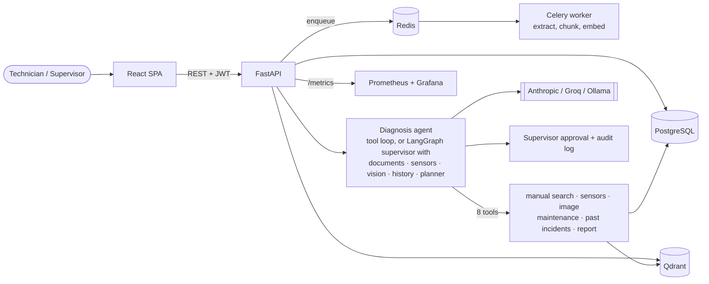

# Industrial Multimodal AI Copilot

[](https://github.com/nithya-prakash/IndustrialAICopilot/actions/workflows/ci.yml)

[](LICENSE)

Diagnosis assistant for manufacturing maintenance teams: a technician asks about a machine, optionally adds a
photo and sensor readings, and gets a diagnosis with citations to the equipment manual. Low-confidence or
high-severity results are held for a supervisor to approve.


*Recorded 2026-10-16 with `scripts/deployment_demo.sh` against a cold start and a local `qwen2.5:7b` through Ollama (waits shortened to 1.5 s). The older recordings below show the web UI with a hosted model.*


*Recorded against the local stack with a real model (Groq `gpt-oss-20b`); the [older recording](docs/images/supervisor-demo.gif) shows a low-confidence result being held and rejected.*

**Status: v1.0, evaluation work in progress.** Known gaps are listed under Limitations: no permanent hosted instance,
small evaluation sets (real-document sets added 2026-10-13 and 2026-10-16), and untested Gemini/OpenAI and vLLM paths.
The PDF extractor now reads multi-column pages column by column ([before/after](docs/real-document-evaluation.md)).

## Why

Plain RAG chatbots answer from whatever they retrieve. On a plant floor a wrong answer has a cost, so here the
agent must gather evidence first (manuals, sensor history, image analysis, maintenance records), any citation it
makes is checked against what it actually retrieved, and anything uncertain goes to a human before it is acted on.

## Key results

| Metric | Result | Dataset and method |
|---|---|---|
| Retrieval MRR (recall@1) | BM25 0.887 (0.849), dense 0.771 (0.717), hybrid 0.863 (0.792), hybrid + rerank 0.959 (0.943) | 53 labelled questions; index = 4 manuals (3 synthetic) plus 6 real documents, 1,204 chunks, re-run 2026-10-16 (on the 111-chunk index of 2026-10-13: 0.948 / 0.855 / 0.962 / 0.969; on the original 44-chunk index: 0.939 / 0.903 / 0.953 / 0.969), `python -m evaluation.retrieval_ablation` |
| Retrieval, paraphrased questions | MRR: BM25 0.442, dense 0.676, hybrid 0.612, hybrid + rerank **0.730** (recall@1 0.66, recall@5 0.82) after lowering the relevance floor from -4.0 to -10.0 (0.633 with the old floor; 0.670 on the 111-chunk index). A larger reranker, `bge-reranker-base`, was tried and dropped: slow on CPU and no better than removing the floor on the one set it finished | 50 questions written to share few words with the manual, same 1,204-chunk index, `python -m evaluation.retrieval_ablation data/evaluation/retrieval_questions_paraphrase.json` |
| Retrieval on real documents | MRR / recall@1: BM25 0.796 / 0.730, dense 0.581 / 0.429, hybrid 0.755 / 0.635, hybrid + rerank **0.950 / 0.921** (0.952 / 0.937 on the 111-chunk index, before the publisher-boilerplate filter and with 1,100 fewer distractor chunks) | 63 questions anchored to evidence phrases in 5 real, two-column DOE tip sheets, now searched among 1,204 chunks. Written by me, not independent. [Details](docs/real-document-evaluation.md) |
| Retrieval on a 321-page real guide | MRR / recall@1: BM25 0.809 / 0.750, dense 0.703 / 0.542, hybrid **0.896 / 0.833**, hybrid + rerank 0.861 / 0.750 (recall@3 1.00 with rerank) | 24 questions anchored to evidence phrases in the PNNL/DOE O&M Best Practices Guide (321 pages, 16 scanned pages OCR-ed), same index; here the reranker did not help. Written by me, so not independent |
| Retrieval on blind-sampled questions | MRR / recall@1: BM25 0.661 / 0.542, dense 0.700 / 0.583, hybrid 0.748 / 0.625, hybrid + rerank **0.853 / 0.792** | 24 questions (14 paraphrased) written from 40 passages sampled at random (seeded) from the real documents, before any retrieval was run on them; written by a language model rather than by me, so a second author but not a human annotator. 1,204-chunk index, `data/evaluation/retrieval_questions_sampled.json` |
| Sensor fault detection on real data | AUROC with all 7 sensors together (Mahalanobis, 95% CI): cooler 1.000 [1.000, 1.000], pump leak 0.998 [0.996, 0.999], valve **0.840** [0.819, 0.857], accumulator **0.738** [0.706, 0.770]; best single metric with the z-score check the sensor tools use: 1.000 / 0.985 / 0.600 / 0.630 | UCI hydraulic test rig, 2,205 real 60 s cycles, healthy half used as baseline, other 3 components vary freely, `python -m evaluation.sensor_fault_eval` |
| RAGAS faithfulness / context precision | 1.00 / 0.91 | 7 questions on the sample manual; judge: local `qwen2.5:7b` |
| Answer quality, tool-loop agent | fact coverage 0.91, citation precision 0.91, overconfident on 2/8 unanswerable questions, unsupported numbers in 1/24 answers | 24 questions (16 answerable, 8 not) on the sample manual, Groq `gpt-oss-20b`, deterministic scoring (`python -m evaluation.answer_eval`); relevance cut-off -4.0 at the time; without it, overconfident on 3/3 unanswerable questions (a different model, `gpt-oss-120b`). The floor was lowered from -4.0 to -10.0 on 2026-10-16 (see the engineering benchmarks); this answer-level run has not been repeated since, so the effect on abstention is not measured |
| Declining unanswerable questions, relevance floor -4.0 vs -10.0 | 7 of 8 declined at both floors (6 + 1 by retrieval at -4.0; 7 by the model at -10.0), 1 answered anyway at both; fact coverage on the 16 answerable 0.870 at -4.0 and 0.913 at -10.0; invented numbers 0/24 at both | local `qwen2.5:7b`, temperature 0, top-3 passages from the production pipeline over the whole 1,204-chunk workspace, deterministic scoring, `python -m evaluation.abstention_eval`; one question is about 4 points |
| Diagnosis latency, supervisor graph | 8.5 s on Groq `gpt-oss-120b`; about 155 s on local `qwen2.5:7b` | one question, same manual |
| Injection screens (116 attacks, 105 benign texts) | regex 50/116 caught (95% CI 35-52%), 4/105 false positives; llm-guard 93/116 (72-86%), 14/105 false positives (8-21%); both 101/116, 18/105 | synthetic template attacks (seed 7) vs. 44 real manual passages, 46 tricky and 15 German benign sentences, `python -m evaluation.injection_eval --llm-guard` |

<details>
<summary>Engineering benchmarks: cut-off check, quantization, load tests</summary>

| Metric | Result | Dataset and method |
|---|---|---|
| Relevance cut-off, held-out check | not reliable: cut-offs tuned on 17 questions scored balanced accuracy 0.4 to 0.65 on 7 held-out ones, and a tighter cut-off blocked a realistic query; shipped as a floor of -4.0, lowered to -10.0 on 2026-10-16 because -4.0 removed the right passage for 14 of 50 paraphrased questions; it now only drops passages the reranker scores as clearly unrelated and is not an abstention mechanism (abstention was re-measured after the change: 7 of 8 declined at both floors) | retrieval scores only, `python -m evaluation.calibrate_cutoff`; far too small to be conclusive |
| Quantization, 4-bit vs 8-bit (qwen2.5 3B on Ollama, Apple Silicon) | 4-bit: 16.7 tokens/s, 2.1 GB, 2.05 s per answer; 8-bit: 12.5 tokens/s, 3.4 GB, 2.57 s; fact coverage 0.78 on both; abstained on unanswerable 7/8 vs 6/8; invented numbers 0/24 on both | 24 questions with top-3 BM25 context, temperature 0, deterministic scoring, `python -m evaluation.quantization_benchmark`; small set, so quality gaps of a few points are noise. vLLM was not run (needs an NVIDIA GPU) |
| API latency under load | read endpoints: p50 10 ms, p95 23 ms, 0 failures in 1,284 requests (14.9 req/s offered); login p50 2.3 s | Locust, 20 users, 90 s, local Docker, rate limits raised |
| AI endpoints under load (app overhead only) | 10 users: 0 failures in 210 requests (tool loop p50 1.1 s / p95 8.3 s, supervisor p50 3.2 s / p95 8.8 s, 2.4 req/s); with 20% of model calls rejected by 429: 0 failures in 191 requests, p95 6.6 s | Locust against a fake OpenAI-compatible server (`loadtest/fake_llm_server.py`, 400 ms per call), so a provider quota is not measured; real model latency is separate (7 to 31 s on Groq) |

</details>

All sets are small and self-written: they check that the pipeline works and show relative differences, not general
accuracy. Reproduce with the scripts in `evaluation/` and `loadtest/`.

## Architecture



- **Hybrid retrieval:** Qdrant dense search plus BM25, fused with Reciprocal Rank Fusion and a cross-encoder reranker.
- **Agent:** a tool-calling loop, or a LangGraph supervisor with document, sensor, vision and history specialists. Citations
  are validated against gathered evidence; confidence and severity are computed outside the model.
- **Human oversight:** the graph pauses with `interrupt()` for low-confidence or high-severity results; every decision is
  written to an append-only audit log, and all queries are tenant-scoped.
- **Incident memory:** a tool retrieves earlier diagnoses that a supervisor approved, by meaning (same workspace only),
  and treats them as background; they never raise the confidence score.
- **MCP server:** the same tools are available to any MCP client as an authenticated, audited, rate-limited service
  account ([`docs/mcp.md`](docs/mcp.md)).
- **Evaluation and observability:** RAGAS scores exported to Langfuse, Prometheus and Grafana for the API.

## Quickstart

```bash
git clone https://github.com/nithya-prakash/IndustrialAICopilot.git && cd IndustrialAICopilot
cp .env.example .env        # choose a provider: Anthropic key, Groq key (LLM_PROVIDER=groq) or local Ollama
docker compose up --build
```

Open http://localhost:3002 and create a workspace (you become its admin). API docs: http://localhost:8000/docs.

**Windows:** install Docker Desktop (WSL 2 backend, at least 6 GB RAM) and Git, then run the same commands in PowerShell
(`copy` for `cp`). Line endings are pinned to LF; the `deploy/*.sh` helpers need Git Bash or WSL. Developed on macOS; the
Windows path has not been run.

Share a live demo from your machine: `deploy/demo-tunnel.sh` starts a single-container build (seeded workspace; logins
`demo_technician` / `demo_supervisor`, password `Demo-Copilot-2026`) behind a free Cloudflare tunnel and prints a public
URL. `deploy/demo-tunnel.sh stop` ends it.

## Tech stack

FastAPI, LangGraph, SQLAlchemy, PostgreSQL, Qdrant, Celery, Redis, sentence-transformers, React, TypeScript,
RAGAS, Langfuse, llm-guard, MCP, Prometheus, Grafana, Locust, Docker Compose, GitHub Actions, pytest.

## Security and design choices

- **Injection:** retrieved text is screened (regex, optionally llm-guard) and flagged; tool output is treated as data.
  llm-guard catches far more (80% vs 43%) but flags 8 of 15 German benign sentences (none of the 44 real manual
  passages). Both barely detect citation-forging and confidence-manipulation attacks, so those are handled structurally:
  citations are checked against retrieved evidence and confidence is computed outside the model.
- **Tool inputs and evidence:** every tool call is validated centrally; passages below a relevance floor are dropped.
- **Unsafe actions:** advice that bypasses safety devices, skips lockout, exceeds ratings or ignores alarms is replaced
  with a safe fallback and forces supervisor approval (rule-based; it cannot judge advice in general).
- **Access:** tenant-scoped queries, role-gated approval where nobody approves their own diagnosis, append-only audit
  log, and an authenticated, rate-limited MCP service account.
- **Supervisor plus specialists** keeps each step's tools and prompt small and observable; the older single tool loop is
  kept because it is faster for easy questions.
- **Hybrid retrieval plus a reranker**, because manuals mix exact terms with paraphrased symptoms. Hybrid beats each
  method alone by only 0.01 to 0.05 MRR, within noise for 53 questions written from the same manual text; a large
  independent corpus is needed to settle it.
- **Approval as a graph `interrupt()` stored in Postgres**, so a pending decision survives restarts and the model never
  acts on its own output. Everything sits behind one provider switch (`LLM_PROVIDER`).

Sample request and a real response: [`docs/sample-input.md`](docs/sample-input.md).

## Data sources

- Sensor history: [Condition monitoring of hydraulic systems](https://doi.org/10.24432/C5CW21), Helwig, Pignanelli and
  Schütze (ZeMA gGmbH / Saarland University), UCI Machine Learning Repository, CC BY 4.0. Download and conversion:
  `scripts/download_real_sensor_data.py` (checksum-verified; outputs are not stored in git).
- Manuals: US Department of Energy tip sheets and the PNNL "Operations & Maintenance Best Practices Guide, Release 3.0"
  (PNNL-19634), US government publications fetched by `scripts/download_real_manuals.py`. The sample motor manual and
  three evaluation manuals are synthetic and generated by scripts in `scripts/`.

## Limitations

- The Anthropic path is covered by mocked tests only (no credits). Live runs used Groq `gpt-oss-120b` and local Ollama
  models; Gemini is wired the same way but has not been called.
- CI fails if the injection screen or BM25 retrieval regress; the LLM-based evaluations and dense/hybrid retrieval are
  run by hand because they need a provider or the vector store.
- A hosted model hit its free-tier daily token cap during testing (the app honors Retry-After and reports quota
  exhaustion); the load numbers above deliberately use a fake model.
- The relevance floor (now -10.0) is not an abstention mechanism: the model does the declining. Lowering it from -4.0 raised paraphrased-question MRR from 0.633 to 0.730; re-measured with a local 7B model, 7 of 8 unanswerable questions were still declined (n = 8, so one question is 12 points). Paraphrased retrieval is still the weakest result (MRR 0.730, recall@1 0.66): a larger embedding model, a larger reranker and an LLM query-expansion step were tried and gave at most +0.03, see [docs/query-expansion.md](docs/query-expansion.md). Many remaining misses return a different, sensible document from the larger index.
- Evaluation sets are small (24 to 63 questions, 116 synthetic attacks) and a 7B model judged a 7B model in the RAGAS
  run. Most question sets were written by me; one 24-question set was written blind by a language model from randomly
  sampled passages. No human other than me has labelled anything.
- Column handling covers vertical gutters only: a sidebar or two-column body is read column by column, but tables, text
  boxes and figures are not modelled. The closing "About DOE" and "PLEASE CONTACT" panels of the DOE tip sheets are
  dropped by a pattern list written for these publishers, so other publishers' boilerplate is still indexed. Link lists
  under "Resources" headings are still indexed. In the 321-page guide, table cells become many one- or two-character
  "headings" and two-column text can interleave (one planned evidence phrase could not be found in any chunk).
- Sensor data is real but small in scope: one hydraulic rig, per-cycle means (no raw waveforms), timestamps assumed
  (the dataset has no clock), and valve and accumulator faults are only weakly detectable with these checks (AUROC
  0.84 and 0.74 at best). The cooler result of 1.000 likely benefits from how the rig was run; treat it as an upper
  bound, not a field figure. The agent's sensor threshold (4.5 mm/s) still comes from the synthetic sample manual and
  does not apply to the hydraulic rig, so no threshold is applied to its metrics.
- Sensor findings are checked against retrieved sensor data and dropped on mismatch; the model's other free text is not.
  A small local vision model gave shallow image observations.
- Incident memory was checked on one live scenario and embeds up to the 200 most recent approved incidents per workspace
  per call, which suits hundreds of incidents, not a large history.
- Paused approvals are checkpointed in Postgres (verified across a backend restart); the checkpoint format is tied to the
  installed LangGraph version.
- No permanent hosted instance: Hugging Face now charges for Docker Spaces, so the demo runs through a tunnel (`deploy/`).

<details>
<summary>Repo layout, tests and more detail</summary>

- `app/`: FastAPI app (`agents/`, `rag/`, `tools/`, `vision/`, `mcp_server/`, `guardrails.py`); `frontend/`: React SPA;
  `evaluation/`: retrieval, RAGAS and injection evaluations; `loadtest/`: Locust; `observability/`: Prometheus, Grafana.
- Tests: `pytest` (backend), run in CI with `ruff` and the frontend build.
- More: [`docs/detailed-notes.md`](docs/detailed-notes.md), [`docs/architecture-decisions.md`](docs/architecture-decisions.md),
  [`docs/security.md`](docs/security.md), [`docs/usage-guide.md`](docs/usage-guide.md), [`docs/mcp.md`](docs/mcp.md).

</details>
